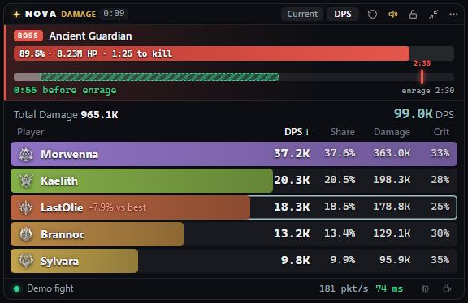

# Nova Meter
A read-only damage meter overlay for **Aion 2**: live party DPS, boss HP with time to kill and the enrage race,
Expedition runs, Nova Ratings for every boss parse, skill breakdowns, fight history and personal bests.

**Download:** grab `Nova-Meter-Setup-x.y.z.exe` from the [latest release](https://github.com/odenness/nova-meter/releases/latest).
Installed copies update themselves.

## What it does
- **In the fight:** DPS, rDPS, nDPS and HPS per player. The boss bar shows HP left and time to kill, and on bosses that
  enrage a ghost bar shows whether your party will beat the enrage timer and how much more DPS it needs (timers are
  built in). It also shows death recaps, your pace against your best kill and connection warnings.
- **Expeditions:** every dungeon visit becomes one run, with clear time, deaths and each boss. The difficulty is worked
  out automatically (Conquest, Exploration, Transcendence stage, Nightmare level), and your fastest clear per difficulty
  is marked.
- **Nova Rating:** each boss parse is rated 0 to 100 against the same class on that boss version, adjusted to your Combat
  Power. 50 is typical and 95 is the top 5%. The meter asks for your CP when it starts, and the rating is saved with the
  fight so it never changes afterwards.
- **Field boss timers and reminders:** open your world map in game and every field boss on it is listed with its
  portrait: who's up (with HP) and the exact respawn time of the rest, straight from the game. Click the bell on any boss
  or event to get a pop-up over the game (on spawn, or 1 to 60 minutes before). It can also keep a live timer dashboard
  in your guild's Discord channel through a webhook.
- **Pet farming:** your pets' levels and souls come straight from the game (no typing in counts). Put pets on your
  target farm (or let target farm mode add them when a soul drops) and watch them count up under the meter:
  "Agrint 23/25". At 25/25 and 75/75 you get a level-up celebration.
- **Breakdowns:** skill names and icons for all nine classes (Brawler included), summons collected on one line, hits,
  rotation and damage taken, plus a fight report for every saved fight.

## Install
1. Install **Npcap** from https://npcap.com/#download (defaults; leave "Restrict Npcap driver's access to Administrators only" unticked).
2. Run the Nova Meter installer. If Windows says "Windows protected your PC", click **More info → Run anyway** (the installer isn't code-signed yet).
3. Play Aion 2 in **borderless windowed** mode. Nova Meter can be started before or after you log in.

Hotkeys: **Ctrl+Shift+L** lock/unlock (click-through) · **Ctrl+Shift+H** hide/show.

## Support
Nova Meter is free. If it helps your raids, you can [buy me a coffee ☕](https://buymeacoffee.com/odenness).

## Privacy
Nova Meter only reads a copy of the game's network traffic through Npcap. It never touches the game, its files or its memory,
and never sends anything to the game servers. Fights and settings stay on your PC (`%APPDATA%\NovaMeter`). While running it
looks up enemy names by NPC ID from the public gamers4.life Aion 2 database, and checks this repository for updates and shared
skill names. If you add a Discord webhook (Boss timers → Alerts & Discord), it posts the boss timers to that channel. Members of
the NOVA legion also share the boss timers they see with the NOVA guild board (switch it off in Alerts & Discord).
Only boss timers are sent, nothing else. No account, no telemetry.

## Data sources
Shipped with the app and refreshed before releases:
- skill names and icons: [aion2hub.com](https://aion2hub.com/database), with [gamers4.life](https://gamers4.life/aion-2/database/en/) as a fallback
- dungeon bosses: aion2hub.com
- enrage flags: gamers4.life; enrage timings: client data via [metabot.gg](https://metabot.gg/en/aion-2/bosses)
- Nova Rating reference figures and boss difficulty: [AionFlex](https://aionflex.gg/meta/bosses) public boss pages
  (class medians and top 5% from real uploaded kills)
- dungeon artwork and boss portraits: metabot.gg
- field boss names, map regions and portraits: the [aion2hub.com](https://aion2hub.com/maps) world map
- pets, soul thresholds and pet portraits: [gamers4.life](https://gamers4.life/aion-2/database/en/pets/)

Not affiliated with NCSOFT. Aion is a trademark of NCSOFT Corporation. Game art, class emblems and skill icons © NCSOFT.
